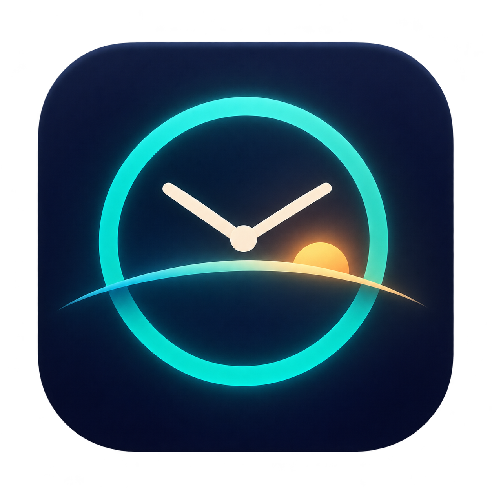

# 时屿 · Horiva



**让每一刻，各在其时。**

[下载最新版本](https://github.com/tayoji-io/Horiva/releases/latest) · [自动打包记录](https://github.com/tayoji-io/Horiva/actions/workflows/package.yml)

“时屿”把不同时区比作时间海中的岛屿。Horiva 是应用的英文名称。图标以钟面、地平线和暖金色日出表达多时区与昼夜。

品牌资产：[PNG](Assets/Brand/Horiva.png) · [macOS ICNS](Assets/Brand/Horiva.icns) · [设计说明](Assets/Brand/README.md)

原生 macOS 菜单栏应用。多个时区并排显示，例如 `上海 20:30 · 洛杉矶 04:30`，不修改系统时区或时间，无网络请求或第三方依赖。

## 界面

设置窗口采用 Stitch 设计的深色实时预览、时区卡片、格式预设卡片和分组设置；内容可滚动，底部操作栏固定。支持调整窗口大小。“更多预设”保留原有格式，底部可恢复默认设置或完成编辑。

## 使用

打开 `dist/Horiva.app`，也可将它拖入“应用程序”。首次启动自动打开设置，此后点击菜单栏时钟 →“时区与格式设置…”。关闭设置窗口后继续运行，无 Dock 图标。

- 搜索中文常用城市名、IANA 标识或英文城市名来添加时区。
- 编辑显示名称，使用箭头调整左右顺序；至少保留一个时区。
- 每个时区均有独立的“显示时区”复选框，取消后菜单栏只显示该时区的时间。原名称保留，可随时重新显示。悬停提示继续标明时区，方便识别。旧版设置自动兼容。
- 可选 12/24 小时、秒、日期，或输入自定义格式并点击“应用”。
- “菜单栏字体”可选择系统字体（数字等宽）或完整等宽字体，选择立即生效并保存；中文使用系统字体回退。
- 下拉菜单仅保留原生操作项，不显示时间预览。需要详情或复制时，可打开日历/会议换算窗口。
- 退出：点击菜单栏时钟 →“退出 Horiva”。

自定义格式使用 Unicode 日期格式，例如 `yyyy-MM-dd HH:mm:ss`、`MM/dd EEE h:mm a`。`MM` 是月份，`mm` 是分钟，`HH` 是 24 小时，`h` 是 12 小时，`a` 是 AM/PM，单引号包含的文字原样显示。星期和 AM/PM 描述跟随界面语言，可选简体中文或 English (US)。

菜单栏空间有限，特别是带刘海的 Mac：过多时区或过长格式可能放不下，可缩短名称/格式或减少时区数量。系统自带时钟仍会保留；本工具增加独立时钟。

设置保存在应用的 UserDefaults（`local.zonebar.clock`），自动处理夏令时和跨日。应用不申请定位、辅助功能或管理员权限，默认不注册开机启动；“系统与启动首选项”中可启用登录启动。应用通过 SMAppService 管理真实登录项，并显示系统批准状态和错误。建议先将应用移入“应用程序”再开启，之后不要移动或重命名。

## 构建与测试

需要 macOS 13+、Xcode / Swift 5.9+。

```sh
swift test
./build.sh
open dist/Horiva.app
```

`build.sh` 生成当前机器架构的 app 和 zip，并使用本机 ad-hoc 签名。当前产物为 Apple Silicon（arm64）；尚未使用 Developer ID 签名或公证。跨机器分发可使用自己的开发者证书签名和公证。

## 系统设置与浮动菜单

- 登录启动：读取 macOS 真实状态，注册失败显示原因，需系统允许时可打开“登录项”设置。
- 夏令时：默认自动跟随 IANA 时区规则。关闭时保存各时区此刻的 UTC 偏移，之后保持固定；新增时区也会固定其当前偏移。重新开启恢复自动规则，不做虚假的渐变时间补偿。
- 日历：设置中的开关控制原生菜单是否显示日历入口；选择后在独立窗口打开，不在菜单内嵌入自定义面板。
- 会议换算：点击面板的“跨时区会议换算器”，打开独立换算窗口，在首个时区选择日期和时间，各时区同步换算；“返回当前时间”恢复实时显示。不读取系统日历或创建会议。
- 原生菜单：仅含日历入口（可选）、会议换算、偏好设置和退出操作。日期、时区详情与复制按钮放在按需打开的独立窗口。
- 语言：简体中文/English (US) 立即生效，保留用户自定义名称及日期格式表达式。
- 分隔符：中圆点、竖线、短横线或双空格，预览与菜单栏同步。

## 刷新与性能

状态栏含秒/子秒格式时每秒更新，不含秒时对齐分钟边界更新；引号里的文字不会误触发秒刷新。格式化器按配置缓存，菜单没有常驻自定义视图。设置预览使用原生文本控件，预设示例不定时刷新；关闭设置/日历/换算窗口时释放其内容及刷新任务。

本机 20 秒 CPU 时间差采样：只显示系统状态栏、启用秒时约 2–3%；分钟格式且设置窗口打开时约 0.15%。秒模式剩余热点是 AppKit 的状态栏快照/重绘；这些数值不是跨设备性能保证。若优先考虑低占用，选择不含 `ss` / `SSS` / `A` 的时间格式。

可用 `python3 scripts/measure_cpu.py <PID> --seconds 20` 重复测量；百分比以单个 CPU 核心为 100%。

## GitHub Actions 自动打包

工作流位于 `.github/workflows/package.yml`，**仅推送 `v*` 标签时触发**，普通提交和 Pull Request 不会触发打包。

标签示例：

```sh
git tag -a v1.4.0 -m "Horiva 1.4.0"
git push origin v1.4.0
```

工作流分别在 `macos-15`（Apple Silicon）与 `macos-15-intel`（Intel）运行测试，构建带图标的应用包，验证签名与架构，再发布 GitHub Release：

- `Horiva-1.4.0-macOS-arm64.zip`
- `Horiva-1.4.0-macOS-x86_64.zip`
- `SHA256SUMS.txt`

应用版本从标签读取；`v1.4.1-rc.1` 等标签会发布为预发行版，应用内部数字版本为 `1.4.1`。重新运行同一标签的流程会更新其 Release 附件。下载包装有本机 ad-hoc 签名，尚未使用 Developer ID 签名或公证。

本地构建默认读取 `VERSION`，也可传入版本号及构建号：

```sh
HORIVA_VERSION=1.4.1 HORIVA_BUILD_NUMBER=8 ./build.sh
```

本地仍保留 `dist/Horiva.app` 和 `dist/Horiva.zip`，同时输出带版本和架构名称的 ZIP。打包流程只使用 GitHub 自带的 `GITHUB_TOKEN`，无需额外配置发布密钥。
